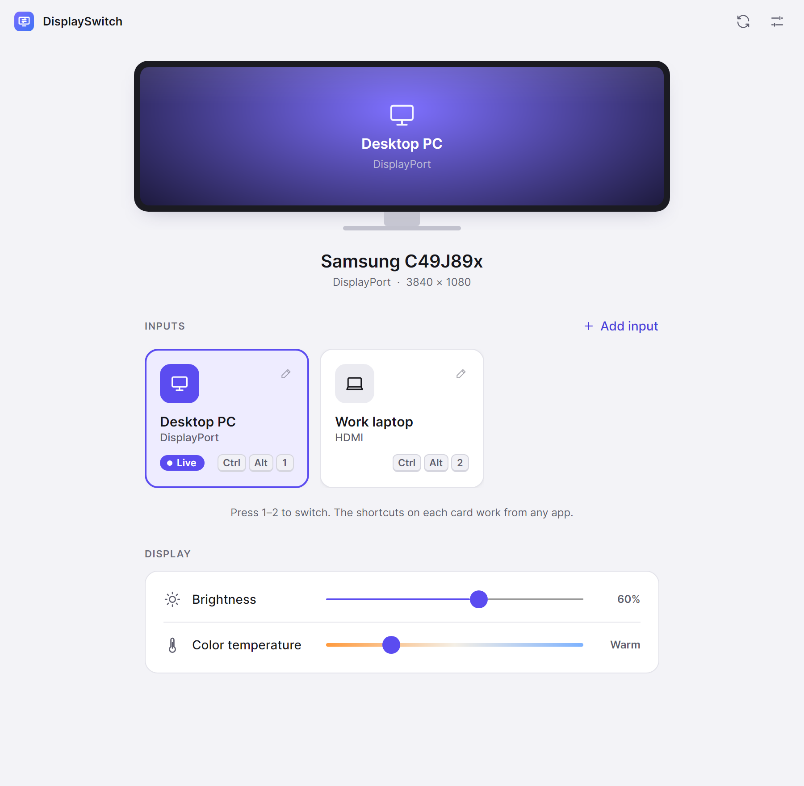
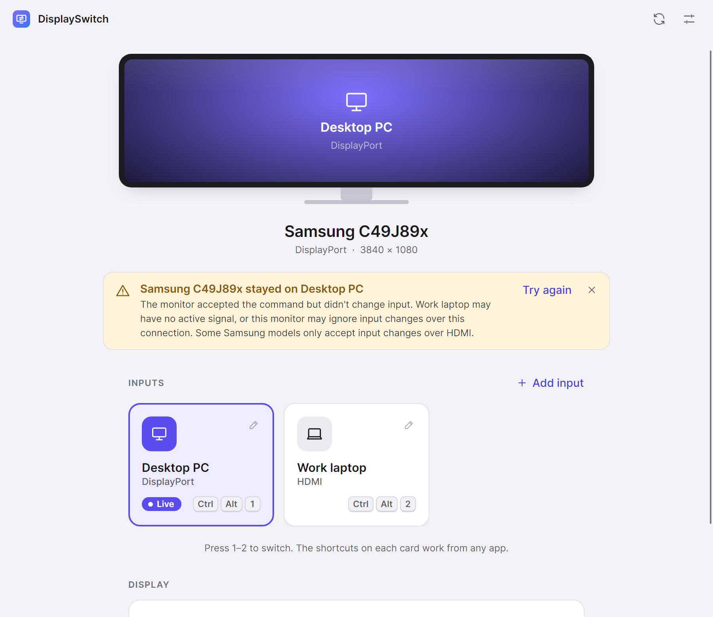
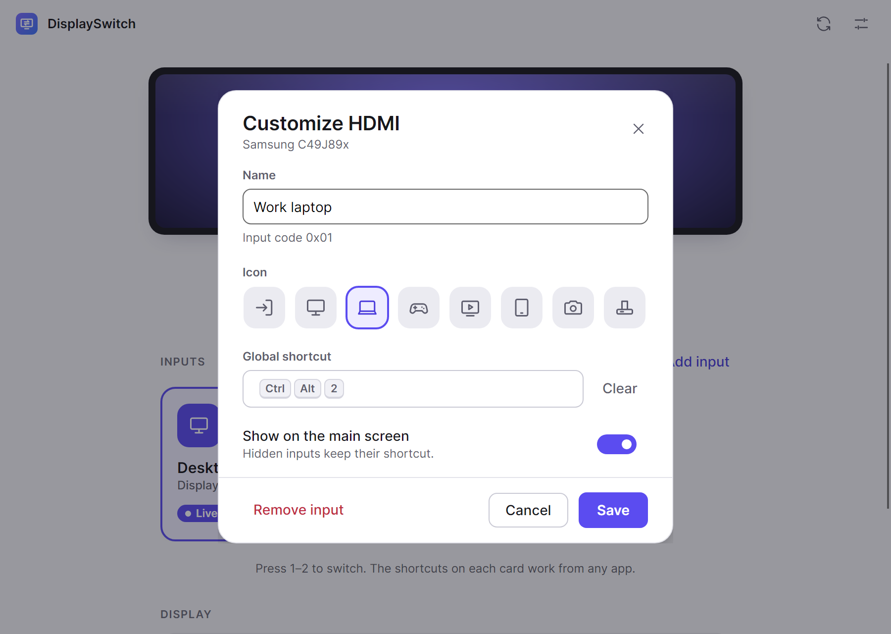
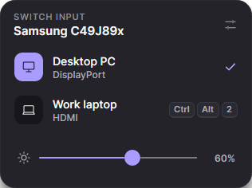
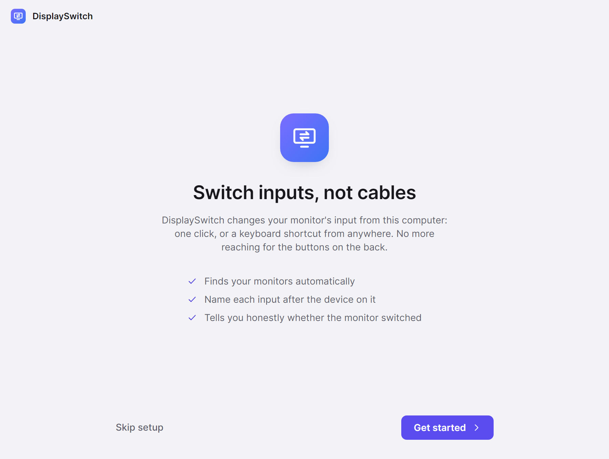
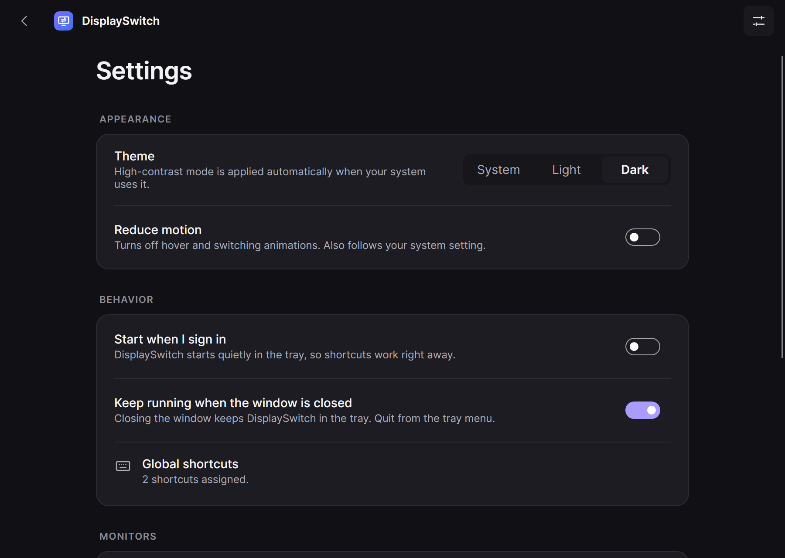

# DisplaySwitch

[](LICENSE)


Switch your monitor's input (DisplayPort, HDMI, USB-C…) from your desktop: one click, or a keyboard shortcut from anywhere. No more reaching for the buttons on the back of the monitor.

DisplaySwitch talks to monitors over **DDC/CI** (VESA MCCS feature `0x60`, *Input Select*). It runs on **Windows, macOS and Linux** from one codebase built with .NET 10 and Avalonia.

<p align="center">
  <picture>
    <source media="(prefers-color-scheme: dark)" srcset="docs/screenshots/home-dark.png">
    
  </picture>
</p>

## Screenshots

<table>
  <tr>
    <td width="50%" valign="top">
      
      <p><b>Honest feedback.</b> "Now showing…" appears only when the monitor confirms the switch. Otherwise DisplaySwitch says what actually happened and what to try.</p>
    </td>
    <td width="50%" valign="top">
      
      <p><b>Make it yours.</b> Name each input after the device on it, pick an icon, and record a global shortcut. Conflicts are flagged before you save.</p>
    </td>
  </tr>
  <tr>
    <td width="50%" valign="top" align="center">
      
      <p align="left"><b>Quick switcher.</b> Click the tray or menu-bar icon to switch without opening the app.</p>
    </td>
    <td width="50%" valign="top">
      
      <p><b>Guided setup.</b> Finds your monitors, lets you name your inputs, and assigns shortcuts on first run.</p>
    </td>
  </tr>
  <tr>
    <td colspan="2" valign="top">
      
      <p><b>Settings.</b> System, light or dark theme (high contrast follows your OS), reduced motion, start at sign-in and tray behaviour.</p>
    </td>
  </tr>
</table>

<sub>Screenshots are rendered from the real app UI with a simulated monitor. Regenerate them with `DISPLAYSWITCH_UPDATE_SCREENSHOTS=1 dotnet test --filter ReadmeScreenshotTests`.</sub>

## Features

- **Automatic monitor detection**, with real model names, connection type and resolution.
- **One-click switching** from input cards, from the tray or menu bar, or with number keys 1–9 in the window.
- **Global shortcuts** such as Ctrl+Alt+1, with conflict detection (Windows).
- **Honest feedback.** "Now showing…" appears only after the monitor confirms the switch. Otherwise the app says exactly what it knows.
- **Your names and icons** for each input ("Work laptop", "PlayStation"). Hide inputs you don't use, or add inputs by code with a safe test that returns automatically.
- **Brightness and color temperature** sliders, in the window and the tray quick switcher. Each change is read back, and the app tells you if the monitor ignored it.
- **Multiple monitors**, each with its own inputs and shortcuts.
- **Light, dark and high-contrast themes**, keyboard navigation, screen-reader labels and reduced motion.
- **Lightweight.** No background polling (0 % CPU while in the tray) and no telemetry. Settings and logs stay on your computer.

## Install

| Platform | Download | Notes |
|---|---|---|
| Windows 10 1809+ / 11 (x64) | `DisplaySwitch-<version>-win-x64-setup.exe` | Installs for your user only; no administrator prompt. A portable `.zip` is also provided. |
| macOS 12+ (Apple silicon) | `DisplaySwitch-<version>-osx-arm64.dmg` | Drag to Applications. Not notarized yet, so on first launch right-click › **Open**. |
| Linux x64 / arm64 | `DisplaySwitch-<version>-linux-x64.tar.gz` | Extract and run `./install.sh`. See *Linux setup* below. |

No .NET installation is needed; every package is self-contained.

> **Signing:** release builds are **not code-signed** unless built with a certificate (see [docs/RELEASING.md](docs/RELEASING.md)). Windows SmartScreen may warn on first run of an unsigned build: choose *More info › Run anyway*.

### Linux setup

DDC/CI on Linux needs the `i2c-dev` kernel module and permission to use `/dev/i2c-*`:

```bash
sudo modprobe i2c-dev && echo i2c-dev | sudo tee /etc/modules-load.d/i2c-dev.conf
sudo groupadd --force --system i2c && sudo usermod -aG i2c "$USER"   # then sign out and in
```

DisplaySwitch detects these problems itself and explains the fix in the window.

## Before you start: turn on DDC/CI

Most monitors ship with DDC/CI enabled, but some hide it in the on-screen menu (often under *System* or *Setup*). If DisplaySwitch reports *"This monitor isn't responding"*, turn DDC/CI on and press Refresh.

## Monitor compatibility

Input switching depends on the monitor's firmware, so not every monitor that answers DDC/CI obeys input changes. DisplaySwitch never claims a switch it hasn't confirmed. Known behaviour, including the **Samsung C49J89x**, is documented in [docs/HARDWARE.md](docs/HARDWARE.md).

If your monitor's inputs are missing or wrongly named, open **Add input**, enter the code, and use **Test this code**. The monitor shows that input for 6 seconds and then switches back automatically.

## Platform support

| Capability | Windows | macOS | Linux |
|---|---|---|---|
| Monitor detection and DDC/CI | ✅ verified on real hardware | ⚠️ implemented (Apple silicon), not hardware-tested | ⚠️ implemented (i2c-dev), not hardware-tested |
| Global shortcuts | ✅ | ❌ not yet (use the menu bar) | ❌ not yet (use the tray; Wayland forbids global key grabs) |
| Tray or menu bar, start at sign-in | ✅ | ⚠️ implemented, not tested | ⚠️ implemented, not tested |
| Installer | ✅ validated install and uninstall | ⚠️ DMG built in CI | ⚠️ tarball and install script built in CI |

## For developers

```bash
dotnet build              # builds with all analyzers; warnings are errors
dotnet test               # 122 automated tests (simulated hardware)
dotnet run --project src/DisplaySwitch.App
```

- [docs/ARCHITECTURE.md](docs/ARCHITECTURE.md): how the code is organised and why.
- [docs/DESIGN.md](docs/DESIGN.md): the design system (tokens, components, motion, accessibility).
- [docs/DEVELOPMENT.md](docs/DEVELOPMENT.md): prerequisites, conventions, debugging DDC/CI.
- [docs/TESTING.md](docs/TESTING.md): what is tested, how, and what was verified on real hardware.
- [docs/RELEASING.md](docs/RELEASING.md): building installers, signing and publishing.
- [CHANGELOG.md](CHANGELOG.md): release notes.

## Contributing

Contributions are welcome, especially **monitor compatibility reports**: input switching depends on each monitor's firmware, and every tested model helps other users. Read [CONTRIBUTING.md](CONTRIBUTING.md) to get started, and please follow the [Code of Conduct](CODE_OF_CONDUCT.md).

Help is particularly wanted with verifying macOS and Linux support on real hardware, and with global shortcuts on those platforms.

## Security

Please report vulnerabilities privately, as described in [SECURITY.md](SECURITY.md), not in public issues.

## License

DisplaySwitch is open source under the [MIT License](LICENSE).

It's built on excellent open-source work, including [Avalonia](https://avaloniaui.net/), [SkiaSharp](https://github.com/mono/SkiaSharp), the [Inter](https://rsms.me/inter/) typeface and the [.NET Community Toolkit](https://github.com/CommunityToolkit/dotnet). See [THIRD-PARTY-NOTICES.md](THIRD-PARTY-NOTICES.md) for every bundled component and its licence.

Product names such as Samsung, HDMI and DisplayPort are trademarks of their respective owners. DisplaySwitch is an independent project, not affiliated with any monitor manufacturer.
